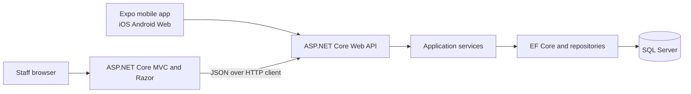

# Verichat CRM and Medical Logistics System

Verichat is a role-based CRM and medical-supplies workflow with a browser-based staff application, an ASP.NET Core API, a SQL Server database, and an Expo mobile client. This README describes the code that is in this repository. 
https://youtu.be/sKW-5iuRPyI 

## Hosted applications

The checked-in publish profiles list these deployment targets:

- **Staff web application:** [http://verichat-crm-web.runasp.net/](http://verichat-crm-web.runasp.net/) — **returns 200**
- **API (deployed host):** [http://api-site.runasp.net/](http://api-site.runasp.net/)
- **API liveness:** [http://api-site.runasp.net/health](http://api-site.runasp.net/health)
- **API readiness and database check:** [http://api-site.runasp.net/api/health](http://api-site.runasp.net/api/health)

These links come from the Web Deploy profiles in `VerichatCRM.Web/Properties/PublishProfiles` and `VerichatCRM.API/Properties/PublishProfiles`, and they were live-checked on 1 Nov 2026. The API host names `api-site.runasp.net`, which is the site `site94518-WebDeploy.pubxml` publishes to; `verichat-crm-api.runasp.net` answers with the same page, so the two names reach either one site or two copies of the same broken deployment — only the hosting panel can tell them apart. **The API does not serve today: every path returns `HTTP Error 500.30 - ASP.NET Core app failed to start`,** which is missing application settings (`ConnectionStrings__DefaultConnection`, `Jwt__Key`), not a code fault — DEPLOYMENT.md §7.1 is the runbook. `/health` reports the process is up; `/api/health` additionally reports database readiness.

Neither site has a TLS certificate bound, so use `http://`. An `https://` request to any `*.runasp.net` name fails at the TLS layer. `VerichatCRM.Web/appsettings.json` and the mobile `API_BASE_URL` fallback both carry the `http://api-site.runasp.net` origin for that reason (`VerichatMobile/.env` is git-ignored, so it matches but is not part of the repository); a signed mobile release build additionally requires a certificate, because Android and iOS block cleartext traffic.

## Architecture



| Project | Responsibility |
| --- | --- |
| `VerichatCRM.Web` | Razor MVC staff UI, role-based navigation, API client, and session-backed web sign-in. |
| `VerichatCRM.API` | JWT authentication, authorization, REST controllers, request validation, application services, and health endpoint. |
| `VerichatCRM.Core` | Domain entities, request/response models, role and status constants, and repository contracts. |
| `VerichatCRM.Infrastructure` | EF Core `AppDbContext`, SQL Server mappings and migrations, repositories, and startup catalogue seeding. |
| `VerichatMobile` | Expo Router application written in TypeScript and React Native, with shared iOS, Android, and web screens. |
| `VerichatCRM.Tests` | xUnit tests for authentication, role-owned data, order validation and stock, and dashboard analytics. |

The API uses .NET 10, ASP.NET Core controllers, EF Core, and SQL Server. The mobile project uses Expo SDK 57 and React Native 0.86. The Task 1 proposal's Firebase Authentication, Firestore, Firebase Hosting, and Cloud Functions are not used by this implementation.

## Implemented workflows

- Staff authenticate through the API; the web app stores the JWT in its server-side session. Mobile stores its token in SecureStore on native platforms and browser local storage on web.
- Role permissions are checked in the API and the web application. Self-registration cannot create an administrator. Client mobile registration creates a corresponding CRM directory record.
- Staff dashboards and analytics query current clients, inquiries, orders, tickets, products, assets, and deliveries. Order totals are labelled as order value; the database does not contain payment or recognized-revenue records.
- The mobile catalogue loads products from the API. Checkout sends a multi-line order; the server uses database prices, validates quantities and stock, updates stock, and associates the order with the signed-in client.
- Staff can issue quotations through the existing sales workflow. The client can view its own issued quotation and line items in the mobile app; staff can view the client's mobile orders and quotations from the web client profile.
- Ticket, asset, delivery, inquiry, pipeline, purchase-order, and warehouse-alert API areas are present. A warranty-expiry query can find assets within a requested number of days.

## Repository map

```text
VerichatCRM.API/Controllers/       HTTP endpoints and access policies
VerichatCRM.API/Services/          Business operations
VerichatCRM.API/DTOs/              API request and response contracts
VerichatCRM.Core/Entities/         Domain and persisted entities
VerichatCRM.Infrastructure/Data/   EF Core context, migrations, repositories
VerichatCRM.Web/Controllers/       Staff MVC actions
VerichatCRM.Web/Views/             Razor screens
VerichatMobile/src/app/            Expo Router screens
VerichatMobile/src/constants/      API clients and mobile state helpers
VerichatCRM.Tests/                 xUnit automated tests
.github/workflows/ci.yml           Pull request and branch CI checks
documentation.md                   Proposal-versus-implementation gap analysis
userguide.md                       Role-by-role operator guide and training plan
DEPLOYMENT.md                      Secret placement, credential rotation, TLS prerequisites
```

### Projects and dependencies

```text
VerichatCRM.Web ──HTTP/JSON──> VerichatCRM.API ──> VerichatCRM.Core
                                      │                    ▲
                                      └──> VerichatCRM.Infrastructure
                                                │
                                                └── SQL Server

VerichatMobile ──HTTP/JSON──────────> VerichatCRM.API
VerichatCRM.Tests ──tests───────────> API/Core/Infrastructure behavior
```

`Core` contains the domain and contracts; `Infrastructure` implements persistence using EF Core; `API` exposes business operations and authentication; `Web` is the staff-facing MVC application; `Mobile` is the Expo client application. The solution file is `VerichatCRM.slnx`.

## Local development

### Prerequisites

- .NET 10 SDK
- SQL Server; on Windows, the checked-in Development connection string uses LocalDB
- Node.js 22 and npm
- A supported Expo device, emulator, or browser

### Clone the repository

```powershell
git clone https://github.com/dBright-dev/VerichatCRM.WIL.git
Set-Location VerichatCRM.WIL
```

### Configure secrets

The JWT signing key is intentionally blank in checked-in settings; supply it outside source control. The production database connection string is too, and it does not need to be set locally at all — `VerichatCRM.API/appsettings.Development.json` carries a LocalDB string that works on its own. Set only the key:

```powershell
dotnet user-secrets init --project VerichatCRM.API
dotnet user-secrets set "Jwt:Key" "<a newly generated random signing key of at least 32 bytes>" --project VerichatCRM.API
```

> If you have ever run `dotnet user-secrets set "ConnectionStrings:DefaultConnection" ...` for a hosted rehearsal, that value outranks the Development file. It no longer breaks the two `dotnet run` commands below — both API launch profiles pin the LocalDB string as an environment variable, which outranks user secrets — but it does silently redirect every `dotnet ef` command, because the EF tools apply only their own environment default and not the profile's variables. The API then spends a minute or more trying to reach that server before it binds a port (`Program.cs:266` runs the migration at startup), and sign-in reports *"The request failed (HTTP 500)"*. Remove it (`dotnet user-secrets remove "ConnectionStrings:DefaultConnection" --project VerichatCRM.API`) unless you are deliberately pointing a local run at another server. `DEPLOYMENT.md`'s Secrets inventory and section 9 explain the precedence.

For a hosted API, set `Jwt__Key`, `ConnectionStrings__DefaultConnection`, and `Cors__AllowedOrigins__0` in the hosting provider's secret/configuration store. The CORS origin must be the exact HTTPS origin serving a browser client; do not add a trailing path. Outside Development the API also refuses to start when the connection string says `Encrypt=False`. The web app's API target is configured by `ApiBaseUrl`. The mobile app accepts `EXPO_PUBLIC_API_URL` and otherwise uses the configured Verichat API host.

> A database password and two JWT signing keys were previously committed across several revisions of `VerichatCRM.API/appsettings.json`. Removing them from current files does not remove them from Git history. Rotate the database credential, replace the signing key in every running environment, and invalidate tokens signed with the old key before deployment. `DEPLOYMENT.md` is the runbook for that, including the history-scrub commands (which are destructive and deliberately not run).

EF Core migration-script generation during publish uses `DesignTimeAppDbContextFactory` and does not start the API host, so publish can build its database script without a JWT secret. The running API still requires both the JWT key and a real database connection string from its environment or secret store.

### Start both tiers with one command

```powershell
.\start-local.ps1
```

This is the recommended way to run the project locally. It starts the API, waits until `/api/health` actually reports `Healthy`, and only then starts the web app — so the ordering mistake that produces `No connection could be made because the target machine actively refused it. (localhost:5184)` cannot happen. Both tiers write to `logs\api.log` and `logs\web.log` (gitignored), and if the API fails to come up the script prints the last lines of its own output instead of leaving you to find a window. Ctrl+C in that terminal stops both tiers.

Add `-Lan` to also bind the API to `0.0.0.0:5184` so a phone or emulator on your network can reach it. That exposes the development API to your local network; use it only while testing, on a network you trust.

Add `-Stop` from any other terminal to shut both tiers down. Use it when a previous run was killed hard enough to skip its own cleanup and an orphaned app host is still holding `:5184` — the next start then fails to bind a port, which looks exactly like a broken database or credential and is neither.

The two sections below describe the same two processes started by hand, which is still the right thing to do in Visual Studio or when you want the tiers in separate terminals.

### Start the API

In PowerShell window 1:

```powershell
dotnet run --project VerichatCRM.API --launch-profile https
```

The Development HTTPS URL is `https://localhost:7076`. On startup the API applies EF Core migrations, seeds a small sample client/product catalogue when those tables are empty, creates the first administrator only when bootstrap settings are supplied, and — on a Development host that asks for it — the per-role sign-in accounts described below.

### Start the staff web application

In PowerShell window 2:

```powershell
dotnet run --project VerichatCRM.Web --launch-profile https
```

The Development HTTPS URL is `https://localhost:7266`. No `$env:ApiBaseUrl` is needed: `VerichatCRM.Web/appsettings.Development.json` already points the web tier at `http://localhost:5184`, which every API launch profile binds, and it blanks `BackupApiBaseUrl` so a local run cannot reach the deployed API by accident.

The web app is a proxy, so **it needs the API window running**. If it is not, sign-in fails with `HttpRequestException: No connection could be made because the target machine actively refused it. (localhost:5184)` — that is not a database or credential problem, it is the other project. In Visual Studio, set both `VerichatCRM.API` and `VerichatCRM.Web` as Multiple startup projects before pressing F5.

The first administrator comes from the API bootstrap configuration (`Bootstrap__AdminEmail`, `Bootstrap__AdminPassword`, and `Bootstrap__AdminName`), or from the development sign-in accounts listed below. Registering through the public form is no longer a way to obtain a staff login on a fresh machine: a self-registered account waits in the approval queue for an administrator to release it, and until an administrator exists there is nobody to release it.

### Start the mobile application

In PowerShell window 3:

```powershell
cd VerichatMobile
npm ci
$env:EXPO_PUBLIC_API_URL = "https://localhost:7076"
npx expo start
```

Physical devices need an API URL they can reach and a trusted HTTPS certificate. A device cannot use its own `localhost` to reach the development computer.

### Sign in as any role

A fresh development database is given one account per role, so every screen in the system can be opened without first working through the approval queue seven times. `DemoUserSeeder` writes them at API startup, and only while **both** conditions hold: the host is running in the Development environment, and `Bootstrap:DemoUsers` reads `true` — set in `VerichatCRM.API/appsettings.Development.json`. Turn either off and no such account is created on that machine; a deployment would have to be handed the Development settings file *and* `ASPNETCORE_ENVIRONMENT=Development` before a single row appeared.

Sign in at `https://localhost:7266/Account/Login`, or point the mobile app at the API. Each role is dropped on its own board:

| Role | Email | Password | Opens |
| --- | --- | --- | --- |
| System Administrator | `admin@verichat.test.local` | `Demo!Admin2026` | `/Admin/Dashboard` |
| Sales Representative | `sales@verichat.test.local` | `Demo!Sales2026` | `/Pipeline` |
| Procurement Manager | `procurement@verichat.test.local` | `Demo!Stock2026` | `/Procurement/Dashboard` |
| Field Support Engineer | `engineer@verichat.test.local` | `Demo!Fix2026` | `/Support/Dashboard` |
| Logistics | `logistics@verichat.test.local` | `Demo!Move2026` | `/Logistics/Dashboard` |
| Client User | `client@verichat.test.local` | `Demo!Client2026` | `/Portal` |
| Medical Student | `student@verichat.test.local` | `Demo!Study2026` | `/Portal` |

The two client roles share `/Portal` because they share what they are allowed to see; the mobile app gives each of them its own screens.

**These are development credentials and nothing more.** They are not passwords for the hosted system and cannot be: the hosted API does not run in Development, so the accounts are never created there, and `Bootstrap__AdminEmail` / `Bootstrap__AdminPassword` remain the only way an administrator is born. The `.test.local` domain is deliberately not routable — approval notices, email-verification links and password resets addressed to these accounts can never reach a real mailbox.

The `Client User` and `Medical Student` accounts also receive the CRM client record that orders, quotations and the enquiry queue are keyed on. That is the same call the approval queue makes when it accepts a client, and without it the portal and the mobile app would open on an empty list rather than a usable account.

With the administrator account, the approval gate itself becomes demoable: register an eighth account through the public sign-up form, leave it `Pending`, and approve or decline it from `/Admin/Approvals`.

## Database and schema

The source of truth is SQL Server, not Firestore. EF Core entities and mappings live in Core and Infrastructure; migrations are in `VerichatCRM.Infrastructure/Migrations`. API startup applies migrations. Do not use production data when demonstrating or testing locally.

The startup seeder adds example clients and products only when the relevant tables are empty, and stops there — tickets, quotations and anything the business actually records are entered by a user. It does not create ordinary user accounts on a deployment; the development sign-in accounts above are a separate, doubly guarded step. Configure the bootstrap administrator credentials as secrets and clear them after initial provisioning.

## Tests and code checks

Run from the repository root:

```powershell
dotnet restore VerichatCRM.slnx
dotnet test VerichatCRM.Tests/VerichatCRM.Tests.csproj --configuration Release
dotnet build VerichatCRM.slnx --configuration Release --no-restore
```

Run mobile checks from `VerichatMobile`:

```powershell
npm ci
npx expo lint
npx tsc --noEmit
```

The current xUnit suite covers 71 authentication, ownership, order, stock, permission-matrix, inquiry-scoring, role-dashboard, and EF design-time context cases across seven test files. It is not a complete integration or end-to-end suite: there are no API contract tests, and the Expo client has no test runner configured (`VerichatMobile/package.json` defines no `test` script), so mobile behaviour is verified by `expo lint` and `tsc` only.

## GitHub Actions

`.github/workflows/ci.yml` restores, tests, and builds the .NET solution and runs Expo lint and TypeScript checks on pull requests and pushes to `main` or `master`. This workflow is CI only: it does not deploy the API, web app, or database. GitHub branch protection, reviewer requirements, deployment environments, and production secrets must be configured in the repository settings separately.


