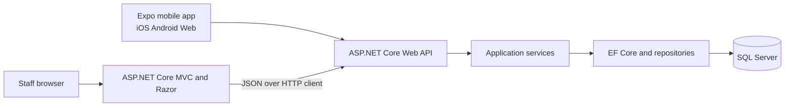

# Verichat CRM and Medical Logistics System

Verichat is a role-based CRM and medical-supplies workflow with a browser-based staff application, an ASP.NET Core API, a SQL Server database, and an Expo mobile client. This README describes the code that is in this repository. The Task 1 PDF is a proposal and contains a Firebase/Firestore design; the implemented persistence and hosting architecture is different, as described below.

See [PRESENTATION_README.md](PRESENTATION_README.md) for a demo runbook and an evidence-based comparison with the Task 2 rubric and Task 1 proposal.

## Hosted applications

The checked-in publish profiles list these deployment targets:

- **Staff web application:** [http://verichat-crm-web.runasp.net/](http://verichat-crm-web.runasp.net/)
- **API health:** [http://verichat-crm-api.runasp.net/health](http://verichat-crm-api.runasp.net/health)
- **API readiness and database check:** [http://verichat-crm-api.runasp.net/api/health](http://verichat-crm-api.runasp.net/api/health)

These links come from the Web Deploy profiles in `VerichatCRM.Web/Properties/PublishProfiles` and `VerichatCRM.API/Properties/PublishProfiles`. They could not be live-checked from the current development environment, so availability and the deployed version are unverified. The `/health` endpoint checks that the API process is running; `/api/health` also checks database readiness.

## Architecture



| Project | Responsibility |
| --- | --- |
| `VerichatCRM.Web` | Razor MVC staff UI, role-based navigation, API client, and session-backed web sign-in. |
| `VerichatCRM.API` | JWT authentication, authorization, REST controllers, request validation, application services, and health endpoint. |
| `VerichatCRM.Core` | Domain entities, request/response models, role and status constants, and repository contracts. |
| `VerichatCRM.Infrastructure` | EF Core `AppDbContext`, SQL Server mappings and migrations, repositories, and startup catalogue seeding. |
| `VerichatMobile` | Expo Router application written in TypeScript and React Native, with shared iOS, Android, and web screens. |
| `VerichatCRM.Tests` | xUnit tests for authentication, role-owned data, order validation and stock, and dashboard analytics. |

The API uses .NET 10, ASP.NET Core controllers, EF Core, and SQL Server. The mobile project uses Expo SDK 57 and React Native 0.86. The Task 1 proposal's Firebase Authentication, Firestore, Firebase Hosting, and Cloud Functions are not used by this implementation.

## Implemented workflows

- Staff authenticate through the API; the web app stores the JWT in its server-side session. Mobile stores its token in SecureStore on native platforms and browser local storage on web.
- Role permissions are checked in the API and the web application. Self-registration cannot create an administrator. Client mobile registration creates a corresponding CRM directory record.
- Staff dashboards and analytics query current clients, inquiries, orders, tickets, products, assets, and deliveries. Order totals are labelled as order value; the database does not contain payment or recognized-revenue records.
- The mobile catalogue loads products from the API. Checkout sends a multi-line order; the server uses database prices, validates quantities and stock, updates stock, and associates the order with the signed-in client.
- Staff can issue quotations through the existing sales workflow. The client can view its own issued quotation and line items in the mobile app; staff can view the client's mobile orders and quotations from the web client profile.
- Ticket, asset, delivery, inquiry, pipeline, purchase-order, and warehouse-alert API areas are present. A warranty-expiry query can find assets within a requested number of days.

## Repository map

```text
VerichatCRM.API/Controllers/       HTTP endpoints and access policies
VerichatCRM.API/Services/          Business operations
VerichatCRM.API/DTOs/              API request and response contracts
VerichatCRM.Core/Entities/         Domain and persisted entities
VerichatCRM.Infrastructure/Data/   EF Core context, migrations, repositories
VerichatCRM.Web/Controllers/       Staff MVC actions
VerichatCRM.Web/Views/             Razor screens
VerichatMobile/src/app/            Expo Router screens
VerichatMobile/src/constants/      API clients and mobile state helpers
VerichatCRM.Tests/                 xUnit automated tests
.github/workflows/ci.yml           Pull request and branch CI checks
```

### Projects and dependencies

```text
VerichatCRM.Web ──HTTP/JSON──> VerichatCRM.API ──> VerichatCRM.Core
                                      │                    ▲
                                      └──> VerichatCRM.Infrastructure
                                                │
                                                └── SQL Server

VerichatMobile ──HTTP/JSON──────────> VerichatCRM.API
VerichatCRM.Tests ──tests───────────> API/Core/Infrastructure behavior
```

`Core` contains the domain and contracts; `Infrastructure` implements persistence using EF Core; `API` exposes business operations and authentication; `Web` is the staff-facing MVC application; `Mobile` is the Expo client application. The solution file is `VerichatCRM.slnx`.

## Local development

### Prerequisites

- .NET 10 SDK
- SQL Server; on Windows, the checked-in Development connection string uses LocalDB
- Node.js 22 and npm
- A supported Expo device, emulator, or browser

### Clone the repository

```powershell
git clone https://github.com/dBright-dev/VerichatCRM.WIL.git
Set-Location VerichatCRM.WIL
```

### Configure secrets

The JWT signing key is intentionally blank in checked-in settings. Configure it and a database connection outside source control. From the repository root, initialize and set API user secrets:

```powershell
dotnet user-secrets init --project VerichatCRM.API
dotnet user-secrets set "Jwt:Key" "<a newly generated random signing key of at least 32 bytes>" --project VerichatCRM.API
dotnet user-secrets set "ConnectionStrings:DefaultConnection" "<your SQL Server connection string>" --project VerichatCRM.API
```

For a hosted API, set `Jwt__Key`, `ConnectionStrings__DefaultConnection`, and `Cors__AllowedOrigins__0` in the hosting provider's secret/configuration store. The CORS origin must be the exact HTTPS origin serving a browser client; do not add a trailing path. The web app's API target is configured by `ApiBaseUrl`. The mobile app accepts `EXPO_PUBLIC_API_URL` and otherwise uses the configured Verichat API host.

> A signing key was previously present in repository configuration. Removing it from current files does not remove it from Git history. Rotate the key in every running environment and invalidate tokens signed with the old key before deployment.

### Start the API

In PowerShell window 1:

```powershell
dotnet run --project VerichatCRM.API --launch-profile https
```

The Development HTTPS URL is `https://localhost:7076`. On startup the API applies EF Core migrations, seeds a small sample client/product catalogue when those tables are empty, and creates the first administrator only when bootstrap settings are supplied.

### Start the staff web application

In PowerShell window 2:

```powershell
$env:ApiBaseUrl = "https://localhost:7076"
dotnet run --project VerichatCRM.Web --launch-profile https
```

The Development HTTPS URL is `https://localhost:7266`. Create the first administrator with the API bootstrap configuration (`Bootstrap__AdminEmail`, `Bootstrap__AdminPassword`, and `Bootstrap__AdminName`) or create a permitted staff account through the registration flow.

### Start the mobile application

In PowerShell window 3:

```powershell
cd VerichatMobile
npm ci
$env:EXPO_PUBLIC_API_URL = "https://localhost:7076"
npx expo start
```

Physical devices need an API URL they can reach and a trusted HTTPS certificate. A device cannot use its own `localhost` to reach the development computer.

## Database and schema

The source of truth is SQL Server, not Firestore. EF Core entities and mappings live in Core and Infrastructure; migrations are in `VerichatCRM.Infrastructure/Migrations`. API startup applies migrations. Do not use production data when demonstrating or testing locally.

The startup seeder adds example clients and products only when the relevant tables are empty. It does not create ordinary user accounts. Configure the bootstrap administrator credentials as secrets and clear them after initial provisioning.

## Tests and code checks

Run from the repository root:

```powershell
dotnet restore VerichatCRM.slnx
dotnet test VerichatCRM.Tests/VerichatCRM.Tests.csproj --configuration Release
dotnet build VerichatCRM.slnx --configuration Release --no-restore
```

Run mobile checks from `VerichatMobile`:

```powershell
npm ci
npx expo lint
npx tsc --noEmit
```

The current xUnit suite covers ten authentication, ownership, order, stock, and role-dashboard cases. It is not a complete integration or end-to-end suite.

## GitHub Actions

`.github/workflows/ci.yml` restores, tests, and builds the .NET solution and runs Expo lint and TypeScript checks on pull requests and pushes to `main` or `master`. This workflow is CI only: it does not deploy the API, web app, or database. GitHub branch protection, reviewer requirements, deployment environments, and production secrets must be configured in the repository settings separately.

## Known implementation boundaries

- The Task 1 document is a design proposal; its Firestore/Firebase stack does not match this SQL Server/.NET implementation and should be revised before it is presented as the deployed architecture.
- The current workflow creates structured quotation records, but the repository does not wire the placeholder PDF/email classes into quotation delivery. Do not describe quotations as emailed PDF documents.
- The Medical Student role and catalogue screen exist in part, but a complete student sign-up, student discount, and role-authorized checkout flow is not implemented.
- The asset API can query warranty expirations; scheduled 60-day notifications are not implemented.
- The API has a health endpoint, not the proposal's global usage, error-rate, or system-load analytics dashboard.
- A Content Security Policy, formal accessibility audit, database-backed integration suite, production deployment workflow, and verified production database connection remain to be completed before claiming the Task 2 rubric is fully met.

