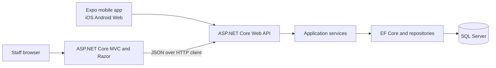

# Verichat CRM and Medical Logistics System

Verichat is a role-based CRM and medical-supplies workflow with a browser-based staff application, an ASP.NET Core API, a SQL Server database, and an Expo mobile client. This README describes the code that is in this repository.

A recorded walkthrough of the running system is at [https://youtu.be/sKW-5iuRPyI](https://youtu.be/sKW-5iuRPyI) and Expo Presentation https://youtu.be/ggRU8IgXqXs 

## Documentation in this repository

Seven documents are part of the repository and refer to each other. If you are looking for one question, this table says which file answers it.

| Document | What it contains | 
| --- | --- | 
| `README.md` | What the system is, how to run it, what is live and what is not. |
| [`userguide.md`](userguide.md) | How each of the seven roles works the system, screen by screen. | 
| [`documentation.md`](documentation.md) | Every requirement in the two project proposals, against the code that meets it or does not. |
| [`VerichatCRM_FeatureWalkthrough.md`](VerichatCRM_FeatureWalkthrough.md) | What the delivered features do, in the order a person clicks through them. |
| [`DEPLOYMENT.md`](DEPLOYMENT.md) | Hosting, where each secret belongs, credential rotation, the migration runbook. |
| [`TRAINING-PLAN.md`](TRAINING-PLAN.md) | Rollout, training sequence, risks and mitigations. | 
| [`DESIGN-SYSTEM.md`](DESIGN-SYSTEM.md) | The brand mark, the palette and the rule that decides whether a screen belongs to it. | 


## Hosted applications

The two applications are deployed as five hosted surfaces, and they are not in the same state, so each one below was requested over HTTP rather than described from the publish profile — results are from **2 November 2026, late**.

| Surface | URL | What it answers |
| --- | --- | --- |
| Staff web application | [http://verichat-crm-web.runasp.net/](http://verichat-crm-web.runasp.net/) | **200.** The landing pages, `/Account/Login` and `/privacy` render, and the login page shows the seven demo chips. This host runs a build from before `b2bca9d`, so a chip is refused by the form's own required-field check and never reaches the API — republishing the web project fixes it. |
| Staff web application, Azure | [https://verichatcrm-egendmhdghfjehdt.eastus2-01.azurewebsites.net/Account/Login](https://verichatcrm-egendmhdghfjehdt.eastus2-01.azurewebsites.net/Account/Login) | **200.** The current build, deployed by the `dev2` workflow: seven chips render and a chip clears the form and calls the API. |
| API on Monster ASP | [http://api-site.runasp.net/health](http://api-site.runasp.net/health) | **200 `Alive`.** The process starts; `/` redirects. |
| API readiness, Monster ASP | [http://api-site.runasp.net/api/health](http://api-site.runasp.net/api/health) | **200 `Healthy`** — `database: Database reachable.` at `latencyMs 0`, `jwt: Healthy`, no pending migrations. `POST /api/auth/login` with a demo address returns a token and its role, so hosted sign-in works against this copy. |
| API readiness, Azure App Service | [https://verichat-api-aqcbgydhhbgbgha5.eastus-01.azurewebsites.net/api/health](https://verichat-api-aqcbgydhhbgbgha5.eastus-01.azurewebsites.net/api/health) | **No answer** since the `5d1f70d` deploy. It was signing tokens with the key committed in `appsettings.json`; that key is gone, `Program.cs` refuses to start on a blank one, so this app needs `Jwt__Key` as an application setting. `DEPLOYMENT.md` §2 is the runbook. |
| API, second Monster name | [http://verichat-crm-api.runasp.net/](http://verichat-crm-api.runasp.net/) | **`HTTP Error 500.30 - ASP.NET Core app failed to start`.** |

## UI/UX Web Application


## Architecture



| Project | Responsibility |
| --- | --- |
| `VerichatCRM.Web` | Razor MVC staff UI, role-based navigation, API client, and session-backed web sign-in. |
| `VerichatCRM.API` | JWT authentication, authorization, REST controllers, request validation, application services, and health endpoint. |
| `VerichatCRM.Core` | Domain entities, request/response models, role and status constants, and repository contracts. |
| `VerichatCRM.Infrastructure` | EF Core `AppDbContext`, SQL Server mappings and migrations, repositories, and startup catalogue seeding. |
| `VerichatMobile` | Expo Router application written in TypeScript and React Native, with shared iOS, Android, and web screens. |
| `VerichatCRM.Tests` | xUnit tests for authentication, role-owned data, order validation and stock, and dashboard analytics. |

The API uses .NET 10, ASP.NET Core controllers, EF Core, and SQL Server. The mobile project uses Expo SDK 57 and React Native 0.86. The Task 1 proposal's Firebase Authentication, Firestore, Firebase Hosting, and Cloud Functions are not used by this implementation.

## Implemented workflows

- Staff authenticate through the API; the web app stores the JWT in its server-side session. Mobile stores its token in SecureStore on native platforms and browser local storage on the web.
- Role permissions are checked in the API and the web application. Self-registration cannot create an administrator. Client mobile registration creates a corresponding CRM directory record.
- Staff dashboards and analytics query current clients, inquiries, orders, tickets, products, assets, and deliveries. Order totals are labelled as order value; the database does not contain payment or recognized-revenue records.
- The mobile catalogue loads products from the API. Checkout sends a multi-line order; the server uses database prices, validates quantities and stock, updates stock, and associates the order with the signed-in client.
- Staff can issue quotations through the existing sales workflow. The client can view its own issued quotation and line items in the mobile app; staff can view the client's mobile orders and quotations from the web client profile.
- Ticket, asset, delivery, inquiry, pipeline, purchase-order, and warehouse-alert API areas are present. A warranty-expiry query can find assets within a requested number of days.

## Repository map

```text
VerichatCRM.API/Controllers/       HTTP endpoints and access policies
VerichatCRM.API/Services/          Business operations
VerichatCRM.API/DTOs/              API request and response contracts
VerichatCRM.API/Validators/        FluentValidation rules for request bodies
VerichatCRM.API/Middleware/        Request body sanitisation
VerichatCRM.API/Hubs/              SignalR hub for live staff notifications
VerichatCRM.Core/Entities/         Persisted domain entities, and the role constants
VerichatCRM.Core/Enums/            Asset, delivery and ticket status vocabularies
VerichatCRM.Core/Interfaces/       Repository and service contracts
VerichatCRM.Core/Models/           Per-area view models, and the shared demo account list
VerichatCRM.Infrastructure/Data/   EF Core context, migrations, repositories
VerichatCRM.Web/Controllers/       Staff MVC actions
VerichatCRM.Web/Views/             Razor screens
VerichatCRM.Web/wwwroot/css/       The design tokens every stylesheet reads
VerichatCRM.Web/wwwroot/pages/     The public landing pages' stylesheets
VerichatMobile/src/app/            Expo Router screens
VerichatMobile/src/constants/      API clients, mobile state, the mirrored demo list
VerichatCRM.Tests/                 xUnit automated tests
Database/                          Hosted migration and schema scripts, applied by hand
.github/workflows/                 CI, plus the two Azure publish workflows
start-local.ps1                    Starts both tiers in the right order, and stops them
```

The six documents the map does not list - `documentation.md`, `userguide.md`, `DEPLOYMENT.md`, `TRAINING-PLAN.md`, `DESIGN-SYSTEM.md` and `VerichatCRM_FeatureWalkthrough.md` - are described in [Documentation in this repository](#documentation-in-this-repository) above, and the scripts in `Database/` are the ones [Database and schema](#database-and-schema) explains.

### Projects and dependencies

```text
VerichatCRM.Web ──HTTP/JSON──> VerichatCRM.API ──> VerichatCRM.Core
                                      │                    ▲
                                      └──> VerichatCRM.Infrastructure
                                                │
                                                └── SQL Server

VerichatMobile ──HTTP/JSON──────────> VerichatCRM.API
VerichatCRM.Tests ──tests───────────> API/Core/Infrastructure behavior
```

`Core` contains the domain and contracts; `Infrastructure` implements persistence using EF Core; `API` exposes business operations and authentication; `Web` is the staff-facing MVC application; `Mobile` is the Expo client application. The solution file is `VerichatCRM.slnx`.

## Local development

### Prerequisites

- .NET 10 SDK
- SQL Server; on Windows, the checked-in Development connection string uses LocalDB
- Node.js 22 and npm
- A supported Expo device, emulator, or browser

### Clone the repository

```powershell
git clone https://github.com/dBright-dev/VerichatCRM.WIL.git
Set-Location VerichatCRM.WIL
```


### Start both tiers with one command

```powershell
.\start-local.ps1
```

This is the recommended way to run the project locally. It starts the API, waits until `/api/health` actually reports `Healthy`, and only then starts the web app — so the ordering mistake that produces `No connection could be made because the target machine actively refused it. (localhost:5184)` cannot happen. Both tiers write to `logs\api.log` and `logs\web.log` (gitignored), and if the API fails to come up the script prints the last lines of its own output instead of leaving you to find a window. Ctrl+C in that terminal stops both tiers.

Add `-Lan` to also bind the API to `0.0.0.0:5184` so a phone or emulator on your network can reach it. That exposes the development API to your local network; use it only while testing, on a network you trust.

Add `-Stop` from any other terminal to shut both tiers down. Use it when a previous run was killed hard enough to skip its own cleanup and an orphaned app host is still holding `:5184` — the next start then fails to bind a port, which looks exactly like a broken database or credential and is neither.

The two sections below describe the same two processes started by hand, which is still the right thing to do in Visual Studio or when you want the tiers in separate terminals.

### Start the API

In PowerShell window 1:

```powershell
dotnet run --project VerichatCRM.API --launch-profile https
```

The Development HTTPS URL is `https://localhost:7076`. On startup the API applies EF Core migrations, seeds a small sample client/product catalogue when those tables are empty, creates the first administrator only when bootstrap settings are supplied, and — wherever `Bootstrap:DemoUsers` reads true — the per-role sign-in accounts described below.

### Start the staff web application

In PowerShell window 2:

```powershell
dotnet run --project VerichatCRM.Web --launch-profile https
```

### Start the mobile application

In PowerShell window 3:

```powershell
cd VerichatMobile
npm ci
$env:EXPO_PUBLIC_API_URL = "https://localhost:7076"
npx expo start
```

Physical devices need an API URL they can reach and a trusted HTTPS certificate. A device cannot use its own `localhost` to reach the development computer.

### Sign in as any role

The system is given one account per role, so every screen can be opened without typing seven accounts into the users screen by hand. `DemoUserSeeder` writes them at API startup

### Login Crediantials 
| Role | Email | Password | Opens |
| --- | --- | --- | --- |
| System Administrator | `admin@verichat.test.local` | `Demo!Admin2026` | `/Admin/Dashboard` |
| Sales Representative | `sales@verichat.test.local` | `Demo!Sales2026` | `/Pipeline` |
| Procurement Manager | `procurement@verichat.test.local` | `Demo!Stock2026` | `/Procurement/Dashboard` |
| Field Support Engineer | `engineer@verichat.test.local` | `Demo!Fix2026` | `/Support/Dashboard` |
| Logistics | `logistics@verichat.test.local` | `Demo!Move2026` | `/Logistics/Dashboard` |
| Client User | `client@verichat.test.local` | `Demo!Client2026` | `/Portal` |
| Medical Student | `student@verichat.test.local` | `Demo!Study2026` | `/Portal` |

## Tests and code checks

Run from the repository root:

```powershell
dotnet restore VerichatCRM.slnx
dotnet test VerichatCRM.Tests/VerichatCRM.Tests.csproj --configuration Release
dotnet build VerichatCRM.slnx --configuration Release --no-restore
```

Run mobile checks from `VerichatMobile`:

```powershell
npm ci
npx expo lint
npx tsc --noEmit
```

The xUnit suite is **140 test cases in ten test files**, all passing (measured on 2 Nov 2026: `Failed: 0, Passed: 140, Skipped: 0` in 8 seconds). It covers authentication and PBKDF2 password migration, account recovery and the login-help path, the permission matrix for all seven roles, client ownership on the controller boundary, order validation and stock movement, inquiry scoring, badge counting, dashboard analytics, and the EF design-time context that lets migrations be scripted without starting the host. Three further files in that project are fakes (`FakeEmailService`, `FakeMobileService`, `FakeUserRepository`), not tests.

## GitHub Actions

Three workflows are checked in, and only one of them is CI.

`.github/workflows/ci.yml` runs on pull requests and on pushes to `main` or `master`, in two jobs: `dotnet` restores `VerichatCRM.slnx`, runs the test project and builds the solution in Release; `mobile` runs `npm ci`, `npx expo lint` and `npx tsc --noEmit` in `VerichatMobile`. It does not deploy anything.

The other two are Azure's own generated publish workflows, and they **run on every push to `dev2`**:

| Workflow | Deploys | To |
| --- | --- | --- |
| `dev2_verichat-api.yml` | `dotnet publish` of the repository | Azure Web App `verichat-api` (Production slot) |
| `dev2_verichatcrm.yml` | `dotnet publish` of the repository | Azure Web App `VerichatCRM` (Production slot) |


